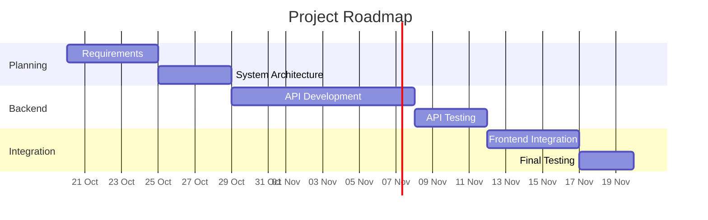

## Overview

Describe the planned development phases and their expected outcomes.

## Phase 1 — Planning and Design

- Define project requirements and scope.
    
- Agree on system architecture.
    
- Define API contracts.
    
- Establish the Git workflow and development standards.
    

**Expected outcome:** Approved requirements and technical design.

## Phase 2 — Backend Foundation

- Set up the FastAPI application.
    
- Implement the initial API endpoints.
    
- Define data models and validation schemas.
    
- Establish the persistence strategy.
    
- Add automated tests.
    

**Expected outcome:** A testable backend foundation.

## Phase 3 — Frontend Foundation

- Agree on frontend architecture.
    
- Set up the Angular application.
    
- Integrate the initial API endpoints.
    
- Implement the first user-facing features.
    

**Expected outcome:** A working frontend connected to the backend.

## Phase 4 — Integration and Validation

- Test end-to-end workflows.
    
- Validate error handling and data consistency.
    
- Resolve integration issues.
    
- Complete technical documentation.
    

**Expected outcome:** An integrated and tested application.

## Phase 5 — Deployment and Handover

- Configure CI/CD.
    
- Deploy the application to the selected environment.
    
- Validate production configuration.
    
- Complete deployment and operational documentation.
    

**Expected outcome:** A deployed and documented application.

## Timeline

Add target dates after estimating effort and confirming team availability.

## Dependencies

Document dependencies between phases and external blockers.

## Change History

Record significant roadmap revisions and their reasons.